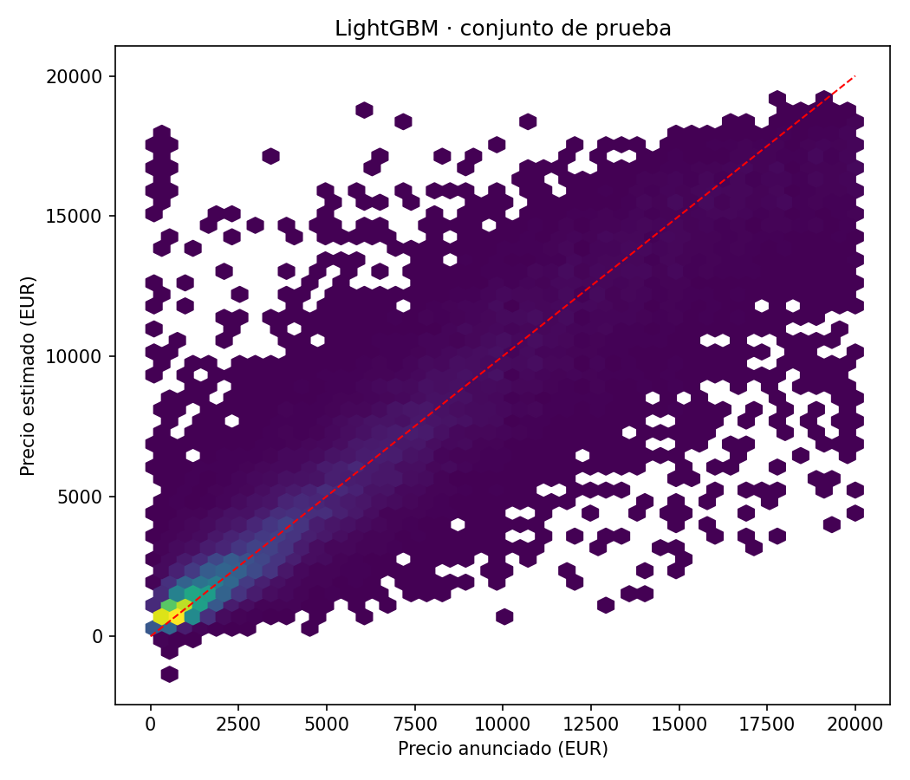
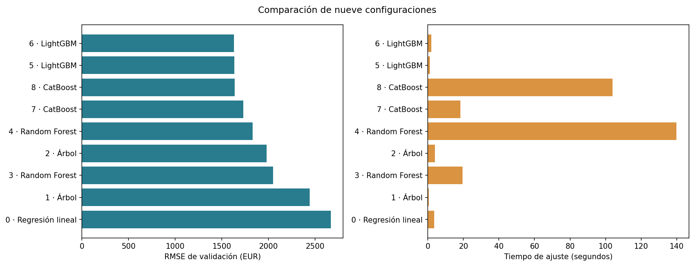

# Predicción de precios de vehículos usados

Desarrollé un modelo para estimar el precio anunciado de vehículos de **Rusty Bargain**. Comparé cinco familias de modelos considerando precisión y tiempo de cálculo, como parte del bootcamp de Data Science de **TripleTen**.

**Autor:** [Luis Eduardo Aguilar Castellanos](https://github.com/EdAgZer03)  
**Tecnologías:** Python · pandas · NumPy · scikit-learn · LightGBM · CatBoost · Matplotlib · Jupyter

## Resultados

| Indicador | Resultado |
|---|---:|
| Modelo seleccionado | LightGBM |
| RMSE de validación | 1628.74 EUR |
| RMSE de prueba | 1639.70 EUR |
| MAE de prueba | 1038.43 EUR |
| Regresión lineal: RMSE de prueba | 2654.51 EUR |
| Reducción de RMSE frente a regresión lineal | 38.2 % |
| Anuncios en prueba | 51,759 |

Seleccioné **LightGBM** por su menor RMSE de validación entre nueve configuraciones. La reducción de error se refiere al mismo conjunto de prueba; no representa un beneficio comercial medido.



## Explora el proyecto

- [Notebook](prediccion_precios_vehiculos.ipynb): preparación, comparación, gráficos y conclusiones.
- [Comparación en validación](reports/validation_comparison.csv): parámetros, error y tiempos de las nueve configuraciones.
- [Resultados en prueba](reports/test_comparison.csv) y [métricas completas](reports/metrics.json).
- [Descripción de los datos](data/README.md) y [resumen de filas](reports/data_summary.csv).

## Problema y decisiones técnicas

Una herramienta de valoración necesita estimaciones útiles y tiempos de cálculo razonables. Mi objetivo fue comparar regresión lineal, árboles de decisión, Random Forest, LightGBM y CatBoost para identificar una alternativa adecuada para este conjunto de anuncios.

1. **Alcance de los datos.** Partí de 354,369 anuncios. Tras eliminar duplicados de las variables analíticas quedaron 309,329; después de los filtros conservé 256,069. Limité los precios a 100–20 000 EUR, los años de matriculación a 1910–2016 y la potencia a 20–1000 CV.
2. **Información ausente.** Representé las categorías faltantes como `unknown`, conservando los anuncios sin inventar sus características.
3. **Preprocesamiento según el modelo.** Utilicé codificación one-hot y escalado numérico en los pipelines de scikit-learn; categorías nativas en LightGBM y CatBoost. Ajusté los transformadores únicamente con los datos de entrenamiento de cada etapa.
4. **Comparación de calidad y tiempo.** Medí el RMSE en euros, el tiempo de ajuste y el tiempo de predicción de cada candidato.

## Diseño de evaluación

Separé grupos de anuncios con características idénticas en proporciones aproximadas de 60 % para entrenamiento, 20 % para validación y 20 % para prueba, con semilla 42. Así evité compartir la misma combinación de variables predictoras entre particiones, aunque los precios de esos anuncios difirieran. Las particiones contienen **153,396**, **50,914** y **51,759** anuncios, respectivamente.

Elegí la configuración por el menor RMSE de validación. Después ajusté el modelo seleccionado sobre entrenamiento y validación juntos y evalué la prueba reservada. Entrené también regresión lineal sobre esa misma unión para comparar ambos modelos en los mismos anuncios finales.

La búsqueda incluye una regresión lineal y dos configuraciones por cada familia de árboles. Los parámetros seleccionados fueron `{"n_estimators": 200, "learning_rate": 0.05, "max_depth": 15}`. La búsqueda es acotada y no demuestra que esta configuración sea óptima para todos los escenarios.



Los tiempos corresponden a un ajuste por configuración en el mismo equipo, usando un hilo en los ensambles. El tiempo de ajuste incluye la preparación de categorías y el preprocesamiento; la predicción de LightGBM utiliza categorías ya preparadas. Son mediciones orientativas, no una prueba exhaustiva de rendimiento ni una garantía de velocidad en otro equipo.

## Ejecución

Entorno de referencia: **Python 3.9.23 en Windows, TripleTen Legacy**. Las versiones principales están en [requirements.txt](requirements.txt) y las dependencias transitivas en [requirements-lock.txt](requirements-lock.txt).

```powershell
python -m venv .venv
.venv\Scripts\Activate.ps1
python -m pip install -r requirements-lock.txt
$env:CAR_DATA_PATH = 'C:\datos\car_data.csv'
python scripts/execute_notebook.py
```

También puedes abrir el notebook en Jupyter y ejecutar todas las celdas con el entorno configurado. El script crea un kernel temporal con el intérprete activo; no requiere registrar un kernel global. Las bibliotecas compiladas pueden necesitar una combinación compatible de Python y sistema operativo.

## Conclusiones y límites

Los ensambles con boosting permiten capturar relaciones que la regresión lineal no representa. En esta comparación, LightGBM obtuvo el menor error de validación y redujo el RMSE final frente a la referencia lineal.

El resultado describe los anuncios conservados tras la limpieza. No cubre vehículos fuera de los límites de precio, antigüedad o potencia. El RMSE no equivale a un porcentaje de error por vehículo; el MAE complementa su interpretación en euros.

La evaluación es aleatoria por grupos, no cronológica. Agrupar especificaciones idénticas reduce solapamientos, pero no identifica vehículos reales sin un identificador individual. Para una aplicación comercial, ampliaría el análisis de errores por segmento y evaluaría datos recientes en orden temporal.
